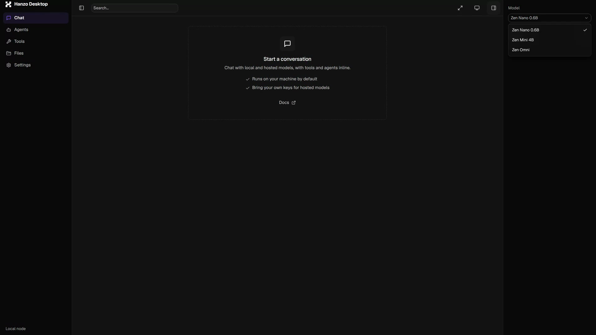

<p align="center"></p>

<h1 align="center">
  
  Hanzo Desktop
</h1>

<p align="center">
  <strong>Native desktop workspace for AI chat, coding agents, design studio, and local or cloud models.</strong>
</p>

<p align="center">
  <a href="https://hanzo.ai/download">Download</a> ·
  <a href="https://github.com/hanzoai/desktop/releases/latest">Releases</a> ·
  <a href="https://docs.hanzo.ai">Documentation</a> ·
  <a href="https://hanzo.ai/security">Security</a> ·
  <a href="https://github.com/hanzoai/.github/blob/main/SECURITY.md">Security Policy</a>
</p>

---

## Overview

Hanzo Desktop packages the Hanzo workspace (`@hanzo/app` + `@hanzo/gui`) into a cross-platform native **Tauri (Rust)** desktop application for macOS, Windows, and Linux.

- **Unified Workspace** — Chat, coding agents (`Hanzo Dev`), visual design studio, and integrated terminals in one desktop window.
- **Local-First or Cloud** — Run models locally via [`hanzoai/engine`](https://github.com/hanzoai/engine) / `hanzod` for full privacy and air-gapped workflows, or connect to your Hanzo Cloud account and BYOK providers.
- **Model Context Protocol (MCP)** — First-class MCP tool integration across local repositories, terminals, and external services.
- **Verifiable & Open Source** — Built from public source in GitHub Actions with hardware-backed code signing (Windows EV RSA-4096 via Cloud KMS OIDC; signed macOS builds) and reproducible source builds.

## Demo

[](https://github.com/hanzoai/desktop/raw/main/assets/hero.mp4)

_Click to play — 31s walkthrough recorded directly from this repository's frontend: onboarding, workspace, Zen models, light/dark themes, and core surfaces._

## Install

Download the latest signed installer for macOS, Windows, or Linux from [hanzo.ai/download](https://hanzo.ai/download) or [GitHub Releases](https://github.com/hanzoai/desktop/releases/latest).

Or use Hanzo in the browser with no install at [hanzo.app](https://hanzo.app).

### System Requirements

- **OS**: macOS 12+, Windows 10+, or Linux (Ubuntu 20.04+ / modern glibc)
- **Memory**: 4 GB RAM minimum (8 GB+ recommended for local model inference)
- **Storage**: 2 GB free space

## Build from Source

Requires Node.js 22+, `pnpm` (11+), and a Rust toolchain (for Tauri).

```bash
git clone https://github.com/hanzoai/desktop.git
cd desktop
pnpm install

# Run the desktop app in development
pnpm dev

# Typecheck, lint, and test
pnpm typecheck
pnpm lint
pnpm test

# Production build
pnpm build
```

## Project Structure

```text
desktop/
├── apps/
│   └── hanzo-desktop/   # Tauri (Rust) host and @hanzo/app frontend
├── libs/
│   ├── brand-config/    # Brand identifiers, OIDC client, callback configuration
│   └── hanzo-logo/      # Shared brand mark component
└── ci-scripts/          # Release and signing automation
```

## Security

- **Architecture & Controls**: [hanzo.ai/security](https://hanzo.ai/security)
- **Vulnerability Disclosure**: See [SECURITY.md](https://github.com/hanzoai/.github/blob/main/SECURITY.md) or email [security@hanzo.ai](mailto:security@hanzo.ai)

## License

See [LICENSE](./LICENSE) and [NOTICE](./NOTICE).
