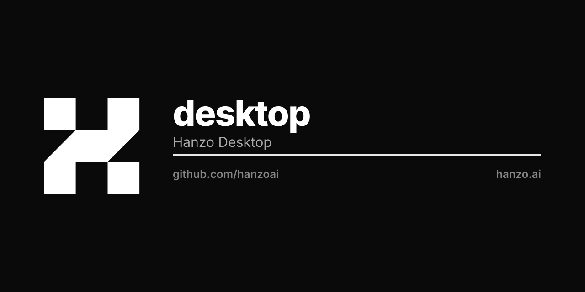

<p align="center"></p>

<h1 align="center">
  
  Hanzo Desktop SDK
</h1>

<p align="center">
  <strong>Open-source SDK, reusable React + Tauri v2 components, Rust desktop crates, and starter templates for building local-first AI desktop apps.</strong>
</p>

<p align="center">
  <a href="https://github.com/hanzoai/desktop/blob/main/LICENSE"></a>
  
  
  
</p>

---

## Overview

`hanzoai/desktop` provides the open-source building blocks for creating cross-platform macOS, Windows, and Linux AI desktop applications with **Tauri v2**, **React**, and **Rust**:

### TypeScript / React Packages (`libs/*`)

| Package | Path | Description |
|---|---|---|
| `@hanzo/desktop-sdk` | `libs/desktop-sdk` | Tauri v2 runtime detection (`isTauriAvailable`, `safeInvoke`, `safeListen`), macOS traffic-light overlay titlebar geometry (`WindowTitlebar`), RFC 8252 PKCE loopback sign-in state machine (`awaitCallback`, `finishAttempt`), and OpenAI-compatible local inference engine client (`probeEngineHealth`, `sendChatCompletion`, `EngineStatusBadge`). |
| `@hanzo/desktop-brand-config` | `libs/brand-config` | Typed multi-brand configuration schema, hostname/environment brand resolution, and public OAuth 2.0 PKCE client metadata. |
| `@hanzo/desktop-logo` | `libs/hanzo-logo` | `<BrandMark />` `currentColor` inline SVG React component and vector brand assets. |

### Rust Desktop Utility Crates (`crates/*`)

| Crate | Path | Description |
|---|---|---|
| `hanzo-log-redact` | `crates/log-redact` | Scrubs PEM private keys, BIP-39 mnemonics, Bearer/Basic auth headers, OAuth/PKCE parameters, and hex/base58 secrets from desktop logs and existing log files on disk. |
| `hanzo-engine-bin` | `crates/engine-bin` | Locates a local OpenAI-compatible inference engine binary (`HANZO_ENGINE_BIN`, bundled sidecar, or `PATH`). |
| `hanzo-projects` | `crates/projects` | Fast, bounded discovery of developer project directories (`~/work`, `~/code`, `~/dev`, `~/src`, `~/Projects`, `~/git`) without reading file contents. |
| `hanzo-shortcut-action` | `crates/shortcut-action` | Pure-Rust mapping from cross-platform `Super`/`Control` global shortcut chords to desktop actions. |

### Starter Example (`examples/*`)

- **`examples/minimal-chat-desktop`**: Minimal, runnable Tauri v2 + React + Vite desktop chat starter wired to `@hanzo/desktop-sdk`, `@hanzo/desktop-brand-config`, `@hanzo/desktop-logo`, and `crates/{log-redact,engine-bin,projects}`. Connects to any local OpenAI-compatible inference server (`hanzo-engine`, Ollama, `llama.cpp`, vLLM) out of the box.

---

## Quick Start

```bash
git clone https://github.com/hanzoai/desktop.git
cd desktop
pnpm install

# Run typechecks, unit tests, and build the starter frontend
pnpm typecheck
pnpm test
pnpm build

# Run endpoint switcher QA smoke tests
node --test test/endpoint_switcher_smoke.test.mjs

# Run the starter frontend in browser preview mode (http://localhost:1420)
pnpm dev

# Run all pure-Rust crate unit tests
cargo test --workspace
```

To launch the native Tauri v2 starter window (requires platform Tauri prerequisites; see [Tauri v2 Prerequisites](https://v2.tauri.app/start/prerequisites/)):

```bash
pnpm --filter @hanzo/desktop-example-minimal tauri:dev
```

---

## Using `@hanzo/desktop-sdk`

```tsx
import { BrandMark } from '@hanzo/desktop-logo';
import {
  EngineStatusBadge,
  probeEngineHealth,
  sendChatCompletion,
  WindowTitlebar,
} from '@hanzo/desktop-sdk';

export function DesktopHeader({ online, models }: { online: boolean; models: number }) {
  return (
    <WindowTitlebar
      icon={<BrandMark brand="hanzo" size={18} />}
      status={<EngineStatusBadge modelCount={models} online={online} />}
      title="My AI Desktop"
    />
  );
}
```

---

## License

Licensed under the [Apache License, Version 2.0](LICENSE). See [NOTICE](NOTICE) for attribution details.
